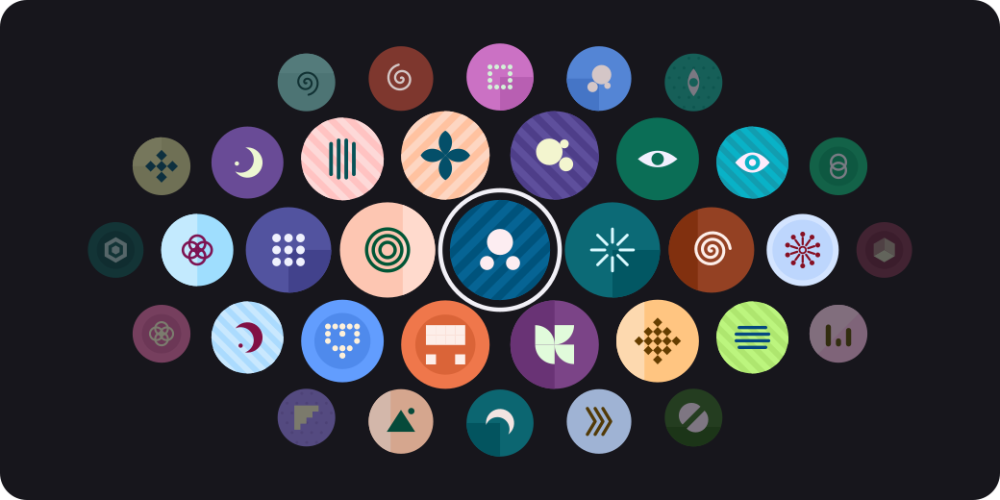
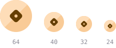
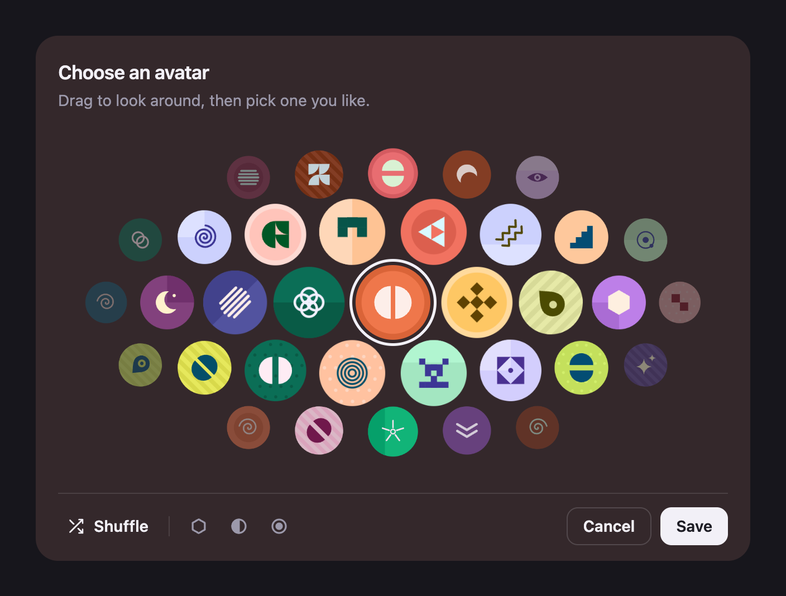
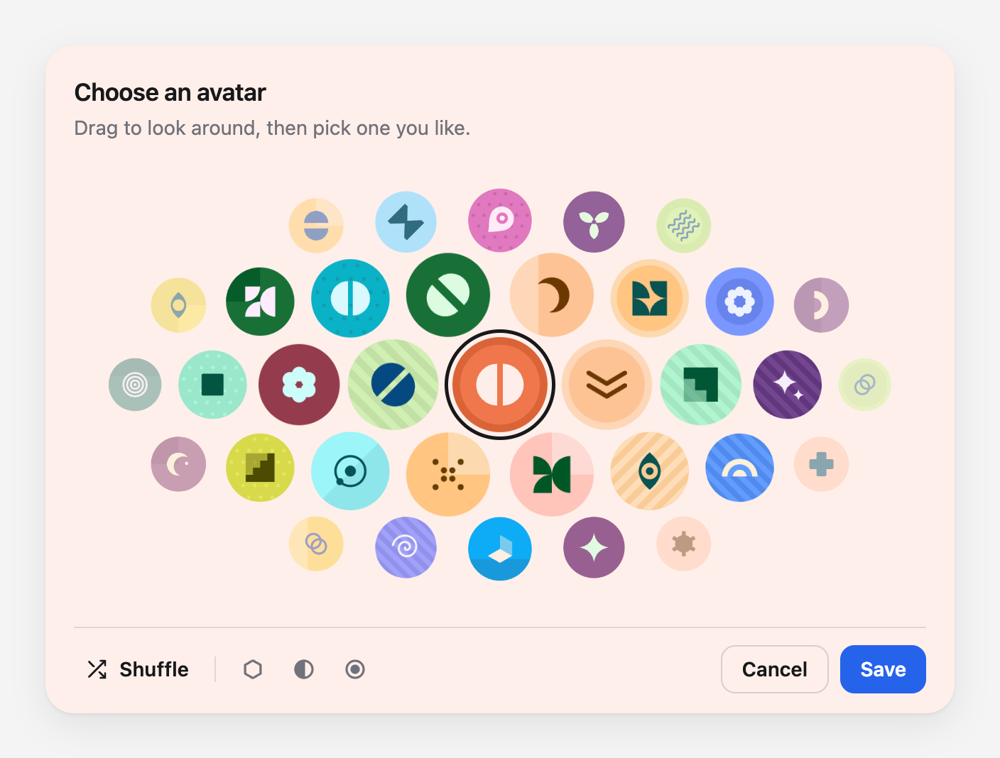
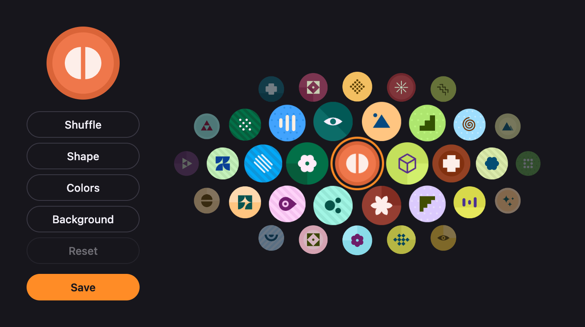
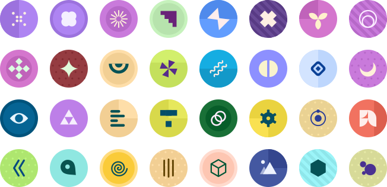

# glyph-avatar

Turn any text into an avatar. The same text always gets the same avatar.

Try it at [kamran.fyi/glyph-avatar](https://kamran.fyi/glyph-avatar).



Pass in a name, an email, an ID or any other text, and get back an SVG. It has no dependencies, runs in the browser and on the server, and comes with React components, including a picker so people can choose their own.

## Install

```sh
npm install glyph-avatar
```

## Usage

```js
import { createAvatar, avatarDataUri } from 'glyph-avatar';

el.innerHTML = createAvatar('maya@studio.dev');
img.src = avatarDataUri('maya@studio.dev');
```


`createAvatar` returns an SVG string. `avatarDataUri` returns the same SVG as a data URI, for an ``, a CSS background or an email. Each text gets its own avatar, and the same text always gets the same one.

### Options

Both take the same options as a second argument.

```js
createAvatar('maya@studio.dev', { shape: 'square' });
createAvatar('maya@studio.dev', { colors: 'curated' });
createAvatar('maya@studio.dev', { glyph: 'flower' });
createAvatar('maya@studio.dev', { background: 'ring' });
```


| Option | Default | What it does |
| --- | --- | --- |
| `size` | `64` | Width and height in pixels. |
| `shape` | `'circle'` | `'circle'` or `'square'`. |
| `radius` | `24` | Corner radius of a `'square'`, out of 100. |
| `colors` | `'generated'` | `'generated'` picks from about 300 color sets, `'curated'` from 14 hand-picked ones. |
| `glyph` | from the text | Always draw this shape. Names are in `GLYPH_NAMES`. |
| `glyphs` | all 32 | Only pick from these shapes. |
| `background` | from the text | Always use this background. Names are in `BACKGROUNDS`. |
| `backgrounds` | all 8 | Only pick from these backgrounds. |
| `palette` | from the text | An index into `PALETTES`, or your own `{ name, bg, fg }`. |
| `title` | none | Adds a title for screen readers. Without it, the SVG is hidden from them. |

### More details

`buildAvatar` returns what was drawn as well as the SVG:

```js
import { buildAvatar } from 'glyph-avatar';

const { svg, glyph, background, palette } = buildAvatar(user.id);
```

`palette.bg` is handy for tinting the card or page around the avatar.

## React

The React components come with the same package. They need React 18 or newer. If you only import from `glyph-avatar`, React isn't needed at all.

### Avatar

```jsx
import { Avatar } from 'glyph-avatar/react';

<Avatar value="maya@studio.dev" size={64} />
<Avatar value="maya@studio.dev" size={40} />
<Avatar value="maya@studio.dev" size={32} />
<Avatar value="maya@studio.dev" size={24} />
```



| Prop | Default | What it does |
| --- | --- | --- |
| `value` | required | The text, or a saved value from the picker. |
| `size` | `40` | Width and height in pixels. |
| `alt` | none | Text for screen readers. |
| `className`, `style` | none | Passed to the wrapping `<span>`. |

It also takes every option above except `title`, such as `shape` or `colors`. Any other prop, like `onClick`, `aria-*` or `data-*`, goes on the `<span>`.

The colors and shapes inside are part of the SVG, so you change them with the options above rather than CSS. Everything around the avatar, like a border, a ring or a shadow, can be styled on the `<span>`.

### AvatarPicker

```jsx
import { AvatarPicker } from 'glyph-avatar/react';

<AvatarPicker
  defaultValue={user.avatar ?? user.id}
  onSave={(value) => updateUser({ avatar: value })}
  onCancel={() => setOpen(false)}
/>
```



People drag, swipe or use the arrow keys to look around a honeycomb of avatars, and pick one. The buttons below change the shape, the colors or the background of the one they picked, or shuffle the whole set. When someone uses the keyboard, a soft halo shows around the picked avatar.

The picker fills the width of its container, so you can put it on a page, in a popover or inside your own dialog. It brings its own styles.

| Prop | Default | What it does |
| --- | --- | --- |
| `defaultValue` | random | The avatar to start on. Pass the saved value, or the user's ID. |
| `onSave` | none | Called with the value to store when they press Save. |
| `onCancel` | none | Shows a Cancel button and calls this when it's pressed. |
| `onChange` | none | Called with the value every time the choice changes. Not called on the first render. |
| `colors` | `'generated'` | `'generated'` or `'curated'`. |
| `title` | `'Choose an avatar'` | Heading above the picker. Pass `''` to hide it. |
| `description` | `'Drag to look around, then pick one you like.'` | Line under the heading. Pass `''` to hide it. |
| `saveLabel` | `'Save'` | Label of the Save button. |
| `className` | none | Added to the picker's outer element. |

`defaultValue` is only read when the picker first appears. To start it over on a different avatar, give it a new `key`.

### Styling the picker

Set any of these CSS variables on the `className` you pass:

```css
.my-picker {
  --ga-panel: #ffffff;
  --ga-ink: #18181b;
  --ga-muted: #71717a;
  --ga-accent: #2563eb;
  --ga-accent-ink: #ffffff;
}
```



| Variable | Default | What it changes |
| --- | --- | --- |
| `--ga-panel` | `#1e1d25` | Background. |
| `--ga-tint-mix` | `12%` | How much the background takes on the picked avatar's color. `0%` keeps it plain. |
| `--ga-ink` | `#f2f0f7` | Text, icons and the ring around the picked avatar. |
| `--ga-muted` | `#9c99ab` | Secondary text and idle icons. |
| `--ga-accent`, `--ga-accent-ink` | `--ga-ink`, `--ga-panel` | Save button background and text. |
| `--ga-ring`, `--ga-ring-width` | `--ga-ink`, `2.5px` | The ring around the picked avatar. |
| `--ga-radius`, `--ga-padding`, `--ga-gap` | `20px`, `20px 20px 14px`, `12px` | Corners, padding and spacing of the picker. |
| `--ga-button-radius` | `8px` | Corners of the buttons. |
| `--ga-title-size` | `17px` | Size of the heading. |

Every part also has a `data-part` attribute (`root`, `header`, `title`, `description`, `honeycomb`, `footer`, `shuffle`, `new-shape`, `new-colors`, `new-background`, `reset`, `cancel`, `save`), so you can style any of them:

```css
.my-picker [data-part='save'] { border-radius: 999px; }
```

### Building your own picker

For a different layout, put the parts together yourself. Use only the ones you need, wrap them in your own markup, and pass `unstyled` to drop the built-in look:

```jsx
import {
  AvatarPickerRoot,
  AvatarPickerHoneycomb,
  AvatarPickerPreview,
  AvatarPickerShuffle,
  AvatarPickerNewShape,
  AvatarPickerNewColors,
  AvatarPickerNewBackground,
  AvatarPickerReset,
  useAvatarPicker,
} from 'glyph-avatar/react';

function SaveButton() {
  const { value } = useAvatarPicker();
  return <button onClick={() => updateUser({ avatar: value })}>Save</button>;
}

<AvatarPickerRoot defaultValue={user.avatar ?? user.id} unstyled className="my-picker">
  <div className="sidebar">
    <AvatarPickerPreview size={88} />
    <AvatarPickerShuffle>Shuffle</AvatarPickerShuffle>
    <AvatarPickerNewShape>Shape</AvatarPickerNewShape>
    <AvatarPickerNewColors>Colors</AvatarPickerNewColors>
    <AvatarPickerNewBackground>Background</AvatarPickerNewBackground>
    <AvatarPickerReset />
    <SaveButton />
  </div>
  <AvatarPickerHoneycomb />
</AvatarPickerRoot>
```



| Part | What it is |
| --- | --- |
| `AvatarPickerRoot` | Holds the state. Takes `defaultValue`, `colors`, `onChange`, `unstyled` and any `<div>` prop. Put every other part inside it. |
| `AvatarPickerHoneycomb` | The draggable honeycomb. Sets its own height from its width. Use one per root. |
| `AvatarPickerPreview` | The picked avatar. Takes the same props as `Avatar`, without `value`. |
| `AvatarPickerShuffle`, `AvatarPickerNewShape`, `AvatarPickerNewColors`, `AvatarPickerNewBackground` | Buttons. They show an icon unless you give them children, and take any `<button>` prop. |
| `AvatarPickerReset` | Goes back to the avatar picked in the honeycomb. Disabled until something changes. The built-in picker hides it while it's disabled. |

`useAvatarPicker()` works anywhere inside `AvatarPickerRoot`. It returns `value`, `changed`, and `shuffle`, `newShape`, `newColors`, `newBackground` and `reset`, for your own buttons.

With `unstyled`, the honeycomb still works and draws its ring, but nothing else is styled. The ring uses `--ga-ring`, then falls back to the text color.

## Saving a picked avatar

The picker gives you a short string like `v1:xzl4n0g:mlda8xw:horizon`. Store it with the user, and pass it anywhere you'd pass text:

```js
createAvatar(user.avatar ?? user.id);
```

People who never pick one still get an avatar from their ID.

Not using React? `stringifySpec` and `parseSpec` make and read the same strings, so you can build your own picker on top of `createAvatar`.

```js
import { stringifySpec, parseSpec } from 'glyph-avatar';

const value = stringifySpec({ seed: 'maya', background: 'ring' });
parseSpec(value); // { seed: 'maya', background: 'ring' }
```

## Stable output

The same text draws the same avatar in every `v1` release, so avatars don't change under people when you update. Saved strings start with `v1:` for the same reason.

## What it draws

32 shapes, 8 backgrounds and about 300 color sets, for around 3.8 million different avatars.



## License

MIT © [Kamran Ahmed](https://kamran.fyi)
